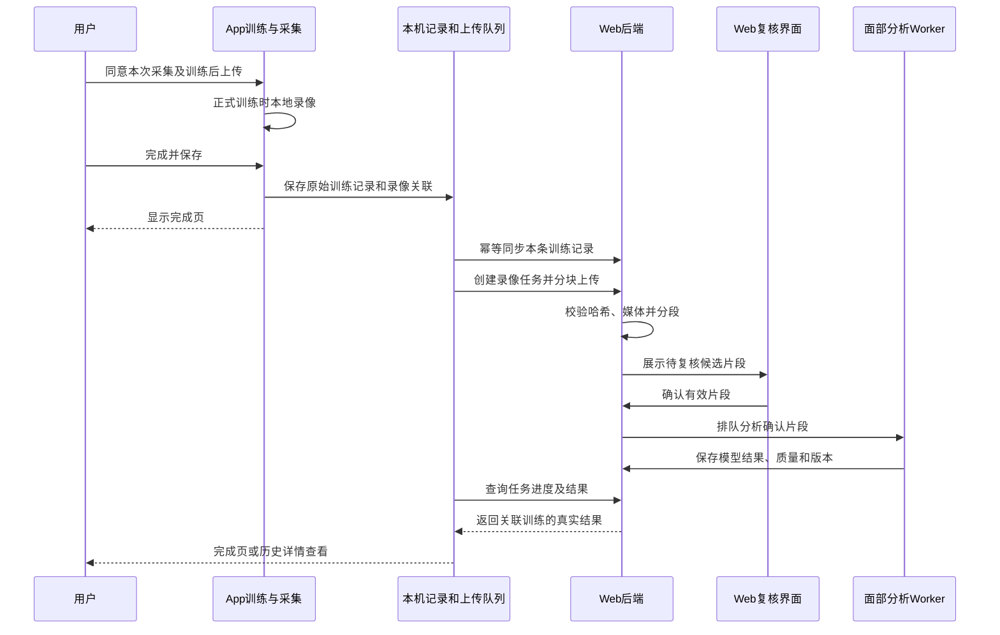

# 琴伴训练视频采集与 Web 面部分析设计

日期：2026-11-04
状态：设计基线。2026-11-04 已开展双端实现，实际交付范围、测试及部署步骤见 [实施交接](2026-11-04-训练视频采集实施与Web交接.md)。本文中的拟定项仍需按交接说明区分。
App 核对基线：`dc25b33` 及当前工作区；Web 核对基线：`cb75a00dbb75d41aa180e452ead64179e96baab4`。

## 1. 设计结论

采用 **App 经授权使用前置摄像头录制训练 → 训练记录保存成功 → 视频通过 HTTPS 上传到 PD-Rehab-Web 后端 → Web 分段、筛选候选并复核 → 模型分析 → 双端查看结果** 的流程。

摄像头为可选功能，每次训练默认关闭。拒绝授权、录像失败、离线或分析服务不可用，都不影响用户原有的钢琴、舞蹈训练和本地成绩保存。沿用四项底栏及现有插画、配色、圆角、字号和交互反馈。

**需要同时开发 App 和 Web。** 现有上传接口只能承接短视频任务，缺少整场训练录像的断点上传、训练记录关联和批次管理。不能仅在训练页加入录像按钮，就宣称整条功能完成。

**上传后也不能直接承诺全自动完成 CausalNet 分析。** 当前 Web 自动寻找候选片段后，仍要求操作者确认起始、峰值、结束三帧。首版将复核放在 Web，App 显示「待复核」。完全自动分析需另行验证和设计。

## 2. 现有项目核对

### 2.1 App 现状

| 位置 | 现有能力 | 本次需要补齐 |
| --- | --- | --- |
| `lib/integration/remote_pages.dart` | `RemoteFacePage` 用 `image_picker` 录制或选择视频、预览、上传、人工选帧、手动查询状态 | 嵌入训练的前置摄像头、训练生命周期联动、持久任务状态 |
| `lib/integration/remote_api.dart` | HTTPS、工作人员登录、患者绑定、短视频 multipart 上传、候选及结果查询 | 可取消、可恢复的上传；录像与训练记录的明确关系 |
| `lib/integration/sync_service.dart` | 钢琴练习、曲目、舞蹈等原始记录的幂等同步 | 上传视频前取得对应的云端训练记录 ID |
| `lib/integration/sync_store.dart` | 独立 `pd_cloud_sync.db`，与原生训练数据库分开 | 采集会话、文件、授权、上传任务、分析结果缓存 |
| `TrainingPage` | 七项钢琴练习，共用训练引擎，有暂停和中断处理 | 接入统一采集服务，避免逐项目复制实现 |
| `PianoPerformancePage` | 曲目正式训练、节拍与音频控制 | 录制生命周期、结果保存后提交 |
| `DancePlayerPage` | 视频跟练、分段切换、暂停、拖动、全屏 | 摄像头与课程播放器并存；记录课程片段与采集时间关系 |

当前 `pubspec.yaml` 已有 `image_picker` 和 `video_player`，没有嵌入式 `camera` 依赖。系统相机录制会离开当前训练界面，不适合作为训练过程采集实现。

当前 Web 登录 token 只保存在联调页面内存里。离开页面后没有可供训练模块长期使用的会话服务，也没有可直接用于后台上传的持久凭证。既有「云端服务联调」入口还受 `PD_CLOUD_INTEGRATION` 编译参数控制。这些都需要在正式采集链路中明确处理。

### 2.2 Web 现状与限制

以下结论来自固定提交的实际源码，仓库代码不代表线上已部署同一版本。

| 能力 | 核对结果 |
| --- | --- |
| 身份 | 复用工作人员 Bearer JWT；设备、本机档案与患者 UUID 必须有效绑定，并检查对象权限 |
| 提交短视频 | `POST /api/integration/v1/face/jobs`；当前只接收 `patient_id`、`device_id`、`local_profile_id`、`video` |
| 文件大小 | 当前接口上限为 `min(服务器 max_upload_size_mb, 50) MiB`，不能因为 Nginx 允许更大文件就认为该接口也允许 |
| 选帧 | `GET /face/jobs/{id}/candidates` 自动找候选；`POST /face/jobs/{id}/review` 人工确认后进入待分析 |
| 分析状态 | `UPLOADING / REVIEW_REQUIRED / PENDING / RUNNING / SUCCESS / FAILED` |
| 调度 | 已有数据库持久化、单实例 dispatcher；`PENDING` 可跨重启保留，上传中或运行中被中断会明确失败或对账 |
| 队列 | 当前最多 8 个活跃任务；上传限频为每账号每分钟 4 次 |
| 超时 | 待复核或待处理任务存在 24 小时过期策略 |
| 原始媒体 | 成功后清理 integration 暂存副本，但评估服务另存的媒体仍可能存在，不能理解成成功后已删除所有视频 |
| 结果读取 | 返回模型名称、版本、预测类别、类别分布和耗时；当前移动端接口未完整暴露质量信息 |
| 关联关系 | `MobileFaceJob` 尚无原始训练记录 ID、整场录像 ID 或分段时间字段 |

CausalNet 当前使用 `negative / positive / surprise` 三类。候选定位处理约 30 秒以内、原始最多 1800 帧的短片；预处理也有帧数校验。普通手机 30 FPS 录像的适用性仍需独立验证，模型输出不能解释成病情、面部运动量表或用户真实心理状态。参考 [现有集成接口](https://github.com/WuChangqing1/PD-Rehab-Web/blob/cb75a00dbb75d41aa180e452ead64179e96baab4/backend/app/api/integration.py)、[任务调度](https://github.com/WuChangqing1/PD-Rehab-Web/blob/cb75a00dbb75d41aa180e452ead64179e96baab4/backend/app/services/integration_jobs.py)、[模型接入说明](https://github.com/WuChangqing1/PD-Rehab-Web/blob/cb75a00dbb75d41aa180e452ead64179e96baab4/docs/causalnet-integration.md)。

仓库另有 `live-emotion` 实时通道，但它与本次「结束后上传录像」的接口、结果和媒体生命周期不同。本设计不将其混用，也不假定它能替代训练录像分析。

## 3. 产品范围

### 3.1 训练覆盖

| 场景 | 设计行为 |
| --- | --- |
| 七项钢琴正式练习 | 共用采集服务，随有效训练开始、暂停、继续、结束 |
| 钢琴曲目正式训练 | 共用采集服务；不录试听、准备页和逐音回顾 |
| 舞蹈跟练 | 支持同一采集入口，记录视频部分、播放位置和切换事件；先验证播放器与编码器并存的设备能力 |
| 入门教学、触摸校准、教程 | 首版不提供采集入口 |
| 历史记录 | 可查看已关联的分析，不为过去的训练补造当时的面部录像 |

建议开发顺序为钢琴曲目 → 七项钢琴 → 舞蹈。舞蹈时用户离设备较远，面部可能过小或出框；质量不达标时只说明有效素材不足，不生成动作完成评价。

### 3.2 录像长度的取舍

推荐最终功能覆盖用户开启采集期间的训练过程，采用**连续本地录制，训练后由服务器切为短片分析**。不将二十分钟训练静默缩减成一次三十秒采样，也不把长视频直接交给现有短片模型。

研发首步可以录制一段 15～20 秒的测试训练，验证手机编码、上传及真实模型推理。这只是技术验证，不作为完整训练录像功能的最终验收。

长训练会增加手机存储、上传流量、服务器解码和复核成本。若后续改为间隔采样，须明确向用户显示采样规则，并在结果中标注覆盖范围。

## 4. 用户流程与页面

### 4.1 准备页

在原有开始练习按钮附近增加一张紧凑卡片。

```text
面部视频采集                                      [关闭]
开启后记录训练中的面部画面，结束后上传分析。
```

打开时展示本次采集说明，包括前置摄像头、不录音、处理服务、关联档案、上传规则及保存期限。用户明确同意后再请求系统相机权限；系统权限已授予也不能代替本次采集及上传授权。可一次明确授权「本次录制并在保存练习后上传」，无需结束时重复弹同一确认。

开启后原位显示预览和「请让面部保持在画面内」。预览保留原比例，不美颜、不做表情滤镜。开始训练前关闭预览即可撤销本次采集。

| 状态 | 页面行为 |
| --- | --- |
| 未配置 Web 地址 | 显示「面部分析服务未配置」，训练照常可开始 |
| 未登录或未绑定 | 提供「连接训练档案」入口；说明录制将发送到哪个档案，不按姓名自动匹配 |
| 模型不可用 | 显示「面部分析暂不可用」，首版不自动积压新录像 |
| 无前置摄像头 | 说明本设备不支持，不自动切换后摄像头 |
| 拒绝权限 | 保持采集关闭；只在用户再次操作时提供重试或系统设置入口 |

首版启用采集前需完成在线登录、有效绑定及服务能力检查；已开启后的网络中断允许离线录制，结束后等待恢复上传。完全离线启动采集留待身份缓存和撤销机制完善后支持。

### 4.2 训练页

- 在现有工具区域放摄像头状态和明显的录制标记，文字为「采集中」「采集已暂停」或「采集已停止」。状态必须可读，不能只依赖颜色。
- 小预览可收起，收起后继续显示录制状态和停止入口。不要把预览覆盖在琴键、乐谱、训练提示或播放器控制上。
- 位置由可用空间、SafeArea 和现有布局约束决定。横屏不足时收起预览，不缩小琴键或重排训练主体。
- 用户可以随时停止后续采集；已有片段可选择保留用于本次提交或删除。关闭后不静默重新开启。
- 舞蹈拖动进度条、切换部分或课程暂停时同步暂停采集，恢复时随训练继续。只记录实际跟练期间的素材及其时间关系。
- 按下状态沿用现有 `QinPress`，缩放包含完整外框；切换开关不触发外层卡片的按下动画。

### 4.3 完成页与历史详情

保留现有成绩、AI 分析、逐音回顾和底部按钮，新增「面部分析」卡片。记录保存优先，录像封装或上传不阻塞成绩展示和返回首页。

| 状态 | 卡片内容及操作 |
| --- | --- |
| 本次未开启 | 不显示新增分析卡片 |
| 正在封装 | 「正在整理本次视频」 |
| 练习尚未保存 | 「练习保存后上传」；先允许重试保存 |
| 等待网络 | 「视频待上传」；显示大小，可取消 |
| 上传中 | 进度、已传字节、暂停 |
| 等待登录 | 「登录后继续上传」；不丢失本次关联 |
| 已上传待复核 | 「视频已上传，等待面部片段复核」 |
| 复核后分析中 | 「正在分析」；允许离开页面 |
| 有效结果 | 显示分析片段数、覆盖时间和「查看详情」 |
| 部分成功 | 分别显示成功、无有效片段、失败的数量 |
| 无有效片段 | 「未找到适合分析的面部片段」，不计为零分 |
| 失败或过期 | 简明原因及适用的重试入口 |

历史记录仍点击进入原完成详情页，在其中回看相同的分析卡片；不新增独立的底栏分类。设置页提供「面部采集与上传」管理入口，查看待上传项目、清理素材和撤回后续授权。

## 5. 授权、身份及媒体生命周期

### 5.1 数据归属

每次采集固定以下上下文：Web 服务地址、操作账号、患者 UUID、本机档案 ID、设备 ID、独立采集 ID、训练类型、本地训练记录 ID。部分训练记录 ID 在结束时才产生，先创建 `capture_id`，保存成功后再绑定真实记录 ID。

录制开始后不允许将同一录像改绑另一患者。退出账号、切换账号或撤销绑定时，暂停对应待上传任务；必须由原本有权限的身份重新核验后恢复。服务器对创建、上传、复核、查询、取消和删除均重新校验对象权限。

当前 Web API 为工作人员身份，不是患者自助登录体系。首版应定位为工作人员帮助绑定的受控使用；如面向患者自行登录，需 Web 增加对应认证、授权和设备凭证方案，不能把工作人员通用账号或固定 token 内置到 APK。

### 5.2 授权分离

相机权限、视频上传授权、AI 训练摘要授权分别管理。允许使用摄像头不代表同意把视频送给大模型。既有 AI 助手的授权不会自动开放摄像头。

训练结束后的自动上传只适用于本次已有明确授权、练习成功保存、身份仍有效且网络条件允许的任务。首版建议默认 Wi-Fi 上传，移动网络显示总大小，用户选择「使用移动网络上传」后才执行。

### 5.3 保存与删除建议

以下为拟定默认值，正式开放前应与 Web 维护者确定并实际落地。

| 数据 | 建议策略 |
| --- | --- |
| 准备阶段预览 | 不写入视频文件 |
| 本机训练录像 | App 私有目录，不进相册，不被系统备份；服务端确认接收并完成摘要校验后，最迟 24 小时内清理本机副本 |
| 未上传或上传失败录像 | 最长保留 7 天，页面显示到期日，允许立即删除 |
| 未成功保存的练习录像 | 暂不上传，保留用于当前保存重试；用户明确放弃则删除 |
| 崩溃遗留录像 | 下次启动对账；未经确认不自动发送，24 小时后清理无关联文件 |
| 服务端未完成上传 | 24 小时过期清理，并释放配额 |
| 服务端待复核录像 | 建议 7 天；**需要调整现有 24 小时规则**，双端显示同一到期时间 |
| 完成分析的原始视频 | 建议结果成功提交后 24 小时内删除所有归属副本及派生人脸图；保留结果、来源、版本和必要质量信息 |
| 模型结果 | 按平台训练记录规则保存，支持独立撤回与删除流程 |

本机录像建议用 Android Keystore 管理的密钥加密保存；采集临时明文在封装、加密成功后立即清理，预览和上传采用受控流式读取。实现时测量加密开销，不在主线程做完整文件复制或加密。

「删除本机视频」和「删除云端录像与分析」是两个明确操作。取消上传并不证明已到达服务端的字节被删除；必须执行云端取消或删除并记录回执。网络中断时显示「删除请求待同步」，不能提前显示已全部删除。备份中的数据也需按已公布策略到期回收。

## 6. 采集技术设计

### 6.1 组件选择

使用 Flutter `camera` 嵌入训练页，Android 优先采用其 CameraX 实现；不再通过系统相机页面录制训练。插件提供摄像头枚举、预览和录像，生命周期资源管理由 App 负责。具体依赖版本在实施时根据当前 Flutter SDK 和真机测试锁定。参考 [Flutter 相机指南](https://docs.flutter.dev/cookbook/plugins/picture-using-camera) 和 [camera 插件说明](https://pub.dev/packages/camera)。

前台录制，不申请后台摄像头。默认 `enableAudio: false`，不录环境对话、不占用麦克风，也不应抢占现有琴键音频播放。显式声明相机权限并将前置摄像头设为可选硬件，避免无摄像头设备无法安装。

### 6.2 初始采集参数

| 参数 | 建议值 | 说明 |
| --- | --- | --- |
| 摄像头 | 前置 | 无可用前摄时降级为普通训练 |
| 编码 | MP4 / H.264，硬件编码优先 | 校验真实编码，不只根据扩展名判断 |
| 分辨率 | 优先 720p，可降至 480p | 依设备能力协商；面部太小时提示调整设备位置 |
| 帧率 | 目标 30 FPS，记录实际帧率与时间戳 | 不插帧，不把普通录像标为高速采集 |
| 视频码率 | 目标约 1.5 Mbps，可按能力调整 | 是请求值，文件大小和真实码率需实测 |
| 音轨 | 无 | 验收文件确实没有音轨 |
| 连续采集上限 | 初始 30 分钟或 400 MiB，先到者停止采集 | 达限提示，但训练继续 |
| 本机缓存总上限 | 初始 1 GiB | 只自动清理符合规则的旧文件；不可静默删除尚未上传的有效任务 |

按 1.5 Mbps 估算，20 分钟约 225 MB，训练录像依然会占手机空间，但不会增加 APK 安装包大小。码率上限、录制时长、存储阈值均放入统一配置，不散落在页面常量中。

录像方向采用编码旋转元数据和真实画面校验，前摄预览可以镜像，分析文件保持可追溯方向。横竖屏变化优先在训练开始前完成；录制中确需切方向时先完成当前文件，再开启新文件，显式记录间断。

### 6.3 生命周期与训练时序

| 事件 | 采集行为 |
| --- | --- |
| 准备页 | 初始化预览，不录制 |
| 正式训练开始 | 创建采集上下文；异步开始录制，不修改训练引擎的起始时钟 |
| 用户或训练引擎暂停 | 暂停录像；保留「采集暂停」状态 |
| 继续训练 | 核验权限与上下文后继续；不支持可靠暂停的设备以新文件接续 |
| 切后台、锁屏、来电 | 停止或封装当前片段、释放摄像头；沿用原训练中断处理 |
| 返回前台 | 不立即偷跑录制；待用户继续训练后恢复 |
| 用户关闭采集 | 结束当前文件，不再自动恢复 |
| 完成并保存 | 先快速进入成绩流程，异步等待录像封装及数据库保存，二者都成功才入上传队列 |
| 退出且不保存 | 删除该次录像；不能改变各训练既有的退出保存语义 |
| 摄像头报错或磁盘不足 | 停止采集并提示，训练继续 |
| 进程被终止 | 只恢复已完整封装文件，不保证损坏 MP4 可修复；不自动上传不完整录像 |

用单调时钟记录录像起止、训练开始、暂停、恢复和内容切换。UTC 用于跨端日期展示，不以可能被修改的系统墙钟计算训练时间差。一个采集会话可包含多个有效文件，文件之间的空档必须保留，不能伪造连续覆盖。

若暂停被编码器移除，需保存「文件时间 → 训练单调时间」的分段映射；舞蹈还保存播放部分、进度和倍速事件。只按开始时间相减会错配暂停后的表情与训练事件。

摄像头错误不能被训练引擎算作错键、未完成次数或反应时间异常。新功能不修改原始成绩公式及记录校验哈希。

## 7. 端到端架构



视频发往 **PD-Rehab-Web 的 HTTPS API**，不发往现有阿里云 DeepSeek 网关。后者继续服务 AI 文本问答；将来只在另行授权后接收必要的结构化面部结果摘要。

App 采用应用级 `CaptureCoordinator`、`WebSessionService`、`UploadQueue`，页面只订阅状态。页面销毁不会丢失已建立的任务；网络和模型结果不回写已封存的训练 payload。

## 8. 本机数据设计

建议在 `pd_cloud_sync.db` 增加迁移，不修改 `practice.db` 既有 v4 记录与成绩哈希。新表须有真正的 `onUpgrade`，不能只改 `onCreate`。

| 表 | 关键字段 |
| --- | --- |
| `capture_sessions` | `capture_id`、`profile_id`、`record_type`、`source_record_id`、`device_id`、`server_origin`、`patient_id`、`operator_id`、`binding_id`、`started_utc_ms`、`capture_state`、`consent_id` |
| `capture_files` | `file_id`、`capture_id`、`sequence`、私有相对路径、加密密钥引用、视频原始明文字节摘要、大小、编码、方向、实际时长、帧率、封装状态 |
| `capture_timeline` | `capture_id`、`file_id`、事件类型、单调时钟偏移、文件内时间、可选训练内容与播放位置 |
| `face_upload_tasks` | `capture_id`、`external_record_id`、`remote_recording_id`、上传状态、已确认分块、尝试次数、下次重试、最后错误、到期时间 |
| `face_analysis_cache` | 云端录像及任务 ID、源训练标识、状态、结果 JSON、模型版本、质量、服务端更新时间 |
| `capture_consents` | 本次范围、说明版本、服务端来源、用途、同意及撤回时间；不存人脸截图 |

数据库只存索引、状态和结果，不存视频 BLOB。文件摘要通过流式计算；加密文件摘要与服务端视频摘要分别定义，不能混用。

现有 `synced_records` 只记是否成功，本次应增加云端记录 ID 映射或独立映射表。已同步的旧记录需通过幂等提交读回服务端 ID，不能凭时间、名称或患者最近一次记录猜测关联。

增加按指定记录同步的方法，采集任务只同步本次关联记录。不要为上传一段新录像就运行 `syncAll()` 扫描、提交整个历史库；既有全量同步入口保留原用途。

## 9. Web 接口扩展草案

**本节接口均为拟新增，尚不存在。** 建议采用向后兼容的协议修订 `1.2`，保留原短视频 `face/jobs` 流程，新增整场录像父任务。双方确认后再更新 OpenAPI。

### 9.1 能力发现

扩展 `GET /api/integration/v1/capabilities`，增加录像能力、协议版本、可接受编码、文件及会话大小上限、推荐分块大小、短片时长和帧数限制、复核方式、保留期限。字段缺失意味着只支持旧短片流程，不能默认当作完整采集服务。

客户端使用「本机可用能力、App 上限、服务端上限」三者交集，服务端独立校验。不要把 50 MiB、30 秒和队列数复制到多个页面。

### 9.2 拟新增接口

下表路径统一以 `/api/integration/v1` 为前缀。

| 方法与路径 | 用途及约定 |
| --- | --- |
| `POST /face/recordings` | 幂等创建父任务，关联已同步的训练记录，登记本次授权和文件清单 |
| `GET /face/recordings/{id}` | 查询整体状态、各文件上传状态、分析覆盖和结果摘要 |
| `PUT /face/recordings/{id}/files/{file_id}/chunks/{index}` | 上传固定索引二进制块，初始建议每块 4 MiB；验证块摘要，重复同块成功，不同内容 409 |
| `POST /face/recordings/{id}/complete` | 校验所有块、总长度和文件 SHA256，原子完成上传并启动媒体处理 |
| `GET /face/recordings/{id}/segments` | 分页返回分段和候选状态，供 Web 复核，不一次返回所有截图 |
| `POST /face/recordings/{id}/segments/{segment_id}/review` | 确认或拒绝候选；与视频摘要、候选版本、帧号和操作者绑定 |
| `POST /face/recordings/{id}/cancel` | 取消未完成任务及后续分析，清理临时素材，处理与推理并发 |
| `DELETE /face/recordings/{id}` | 按对象权限删除该录像、派生素材及其分析关联，返回可查询的删除回执 |
| `GET /face/recordings?external_record_id=...` | 按训练记录查询关联录像，便于重装后或 Web 历史页回读 |

创建父任务的字段草案：

```json
{
  "client_capture_id": "客户端生成的UUID",
  "device_id": "设备本地ID",
  "local_profile_id": "本机档案ID",
  "patient_id": "服务端患者UUID",
  "external_record_id": "已同步的训练记录UUID",
  "record_type": "PIECE_PERFORMANCE",
  "source_record_id": "原始本地训练记录ID",
  "capture_started_at": "UTC时间",
  "consent": {
    "version": "face-capture-v1",
    "scope": ["face_recording", "web_face_analysis"],
    "agreed_at": "UTC时间"
  },
  "files": [
    {
      "file_id": "客户端文件UUID",
      "sequence": 0,
      "size_bytes": 1000000,
      "sha256": "视频文件SHA256",
      "mime_type": "video/mp4",
      "duration_ms": 10000
    }
  ],
  "timeline_version": 1,
  "timeline": []
}
```

示例的大小和时长仅说明字段，不是录制配置。时间线分段、编码和方向的具体 schema 需在 OpenAPI 中补齐；体积超限时单独上传受限 manifest。

服务端核验 `external_record_id` 确属同一个设备、档案、患者、训练类型和来源记录。不能只验证患者 UUID 存在。幂等键包含账号归属、设备及 `client_capture_id`，绑定清单哈希；响应丢失后以同键重新创建可拿回同一任务。

块序号、预期长度、摘要、文件数量和总预算都必须校验，不能接受任意稀疏大索引消耗磁盘。块写入成功并落库后才返回确认，整个文件验证成功后才进入分析。

取消与完成、复核与删除采用事务性状态转换。模型即使晚返回，也不能将已取消、删除或失去授权的任务恢复成成功。

### 9.3 服务端模型与调度

新增父级录像、文件、分段和授权记录，复用现有评估结果及 CausalNet 适配器。训练原始记录保持不可变，通过关联表补充结果，不改写既有同步 payload。

当前 8 个活跃任务和每分钟 4 次短片上传不能原样套到整场录像的每个分块上。新增接口分别控制父任务数量、每账号待处理总字节、分块并发、解码并发和推理并发；限制达到后返回可重试状态及 `Retry-After`。

沿用单实例服务可先用数据库队列，但需补齐父任务和分段的原子领取、崩溃恢复及已提交结果对账。在独立 Worker 进程处理解码与模型；不要为每一段重新加载权重。未来多实例时再扩为支持租约的分布式队列，不声称现有单实例 dispatcher 已具备该能力。

## 10. 长视频分段、复核与结果

### 10.1 分段规则

服务端接收完整文件后先检查格式、实际时长、帧数、尺寸、方向及可解码性，再按原始时间戳生成短片。初始建议每段约 20 秒，相邻约 1 秒重叠，避免变化恰好落在边界；每段仍须满足真实帧数不超过 1800、候选时长不超过现有上限的约束。

优先按关键帧解码而不是仅按字节切割 MP4。如必须重新编码，保留来源时间映射、实际帧率和处理版本，不插帧或伪造采集信息。高帧率输入按帧数缩短分段。跨文件或暂停空档不拼成伪连续片段。

重叠区域候选按来源文件和原始时间区间去重。没有稳定起止、面部不清、多人、持续头动或无可靠变化的片段标记为不可分析；不得强行挑出一组帧凑结果。

### 10.2 Web 复核

在患者对应的随访或软件端训练详情增加「训练面部录像」区，展示训练项目、日期、采集覆盖、待复核数量和录像到期时间。操作者可按源时间查看候选的开始、峰值、结束画面，并确认、拒绝或按现有规则手动调整。

普通用户 App 不展示原始帧号和模型参数，只显示处理状态。Web 操作者仍需有该患者及录像的访问权限；不能因为具有患者读权限就自动绕过现有任务所有者限制。协作复核如需新增角色策略，须显式扩展并测试。

首版按片段确认，不提供未经验证的「一键全选并分析」。复核不会要求用户训练时做指定表情，避免干扰训练本身。

### 10.3 结果展示

详情展示分析所覆盖的训练时间、有效片段数、每片段模型类别及相对分数、质量提示、模型版本、分析时间。对照训练阶段时只说明时间对应关系，不用它推断某次错键导致负向情绪。

现有移动端结果接口应补齐质量和来源字段，包括真实 FPS、选帧来源、处理版本、低帧率标识及适用性限制。原模型三分类不扩展成七分类，也不将最大 softmax 分数显示为「准确率」。

一次训练允许得到多个片段结果。**不对片段分数直接平均成「本次情绪」或「康复分数」。** 父任务状态可为成功、部分成功、无有效片段、失败；成功数量只代表分析完成数量。自然训练视频的适用效果需另行收集跨人、跨设备数据评估。

## 11. 上传、恢复和失败处理

采集状态、上传状态、分析状态独立保存。不能用一个 `busy` 同时控制录像、成绩保存和上传。

```text
采集：关闭 → 预览 → 录制 ↔ 暂停 → 封装 → 已就绪
                              ↘ 已停止 / 失败 / 已丢弃

上传：等待成绩保存 → 等待记录同步 → 等待网络或登录 → 上传中 → 已接收
                                                        ↘ 可重试 / 已取消

分析：预处理 → 待复核 → 排队 → 运行 → 成功 / 部分成功 / 无有效片段 / 失败
```

- 初始上传并发为 1 个文件，流式读块、报告进度、支持取消；不把整段录像载入 Dart 内存。
- 请求失败按退避和抖动重试，遵守 `Retry-After`，达到上限改为手动处理。
- 401 等待重新登录；403 或绑定撤销停止任务；413 按能力限制处理；格式和解码错误不盲目重试。
- 服务端已经接受文件但客户端没收到响应时，先查远端状态，不能重复创建新分析。
- 结果页面可按 2、5、10 秒递增间隔查询，页面离开、App 进入后台、任务终态后停止高频轮询。
- 训练重复进入完成页、重复点击保存、重新打开 App，不应创建重复采集或分析任务。
- 「再练一次」创建新 `capture_id`，不能把上一场的视频继续写入下一次训练。

首版建议实现**前台上传、持久任务、重新打开后恢复**。应用内切页不打断服务；系统终止 App 后不承诺上传继续。当前内存 token 失效时登录后恢复，而不是落库长期保存工作人员密码或 JWT。

如要保证用户离开 App 后尽可能继续传输，另加安全的可撤销设备凭证，并按系统版本选择用户发起的数据传输任务或 WorkManager。Android 对后台任务有时机和配额限制，不能靠一个 Dart Timer 保证执行；Android 16 的长任务配额也需实测。参考 [Android 数据传输任务选择](https://developer.android.com/develop/background-work/background-tasks/data-transfer-options) 和 [长任务约束](https://developer.android.com/develop/background-work/background-tasks/persistent/how-to/long-running)。后台传输方案不包含后台录像。

## 12. 性能、界面与安全要求

1. 摄像头由应用级协调器单实例持有；开始、暂停、关闭操作串行化，使用代际标识阻止旧异步回调恢复已关闭的采集。
2. 主线程只更新必要状态。录像由平台编码器完成，不将逐帧图像传到 Dart 做录制；预览、进度条和训练页面局部监听，避免全页高频重建。
3. 视频哈希、加密、磁盘检查和上传不得阻塞训练主线程。优先结束训练后处理重任务，低内存、过热时停止采集优先保证练习。
4. 钢琴音频、计时和触摸链路保持现有实现；使用真机比较开启、关闭采集时的音频中断、卡顿和性能分布。
5. 舞蹈播放器和摄像头编码器同时占用资源，必须单独验证；失败时降级为普通舞蹈训练。
6. 所有文件名由服务端生成，校验实际媒体，不信任扩展名和客户端元数据；访问视频与缩略图必须鉴权，不能暴露公共静态上传目录。
7. 敏感日志只保留请求 ID、状态和耗时；不记录 token、完整本地路径、视频内容或真实患者身份。视频、截图、密钥不提交 GitHub。
8. 首版做中英文、主题、高对比度、读屏和大字号适配。使用布局约束决定卡片及预览大小，不根据某品牌型号写分支，不缩小可点击区域来硬塞控件。

## 13. 拟涉及文件与责任划分

| 端 | 模块 | 工作 |
| --- | --- | --- |
| App | `lib/platform/training_camera.dart`（新增） | 相机能力、权限、预览、录像、生命周期隔离 |
| App | `lib/features/capture/`（新增） | 统一采集控制、授权与预览组件、完成页状态卡 |
| App | `lib/integration/web_session_service.dart`（新增） | 将页面内登录会话提升为明确的应用级服务，处理退出及过期 |
| App | `lib/integration/face_upload_queue.dart`（新增） | 分块、取消、恢复、结果查询 |
| App | `lib/integration/sync_store.dart` | 侧库迁移与索引，录像和训练的关系 |
| App | `lib/integration/remote_api.dart` | 新协议客户端；旧短片联调入口继续兼容 |
| App | 三类正式训练页及其准备、完成页 | 连接采集生命周期，不复制相机底层实现 |
| App | Android manifest、依赖、构建配置 | 相机可选权限、插件及功能开关；原四项导航保持 |
| Web | `backend/app/api/integration.py` 及独立录像服务 | 新增父任务、分块、状态和删除接口 |
| Web | 数据模型、Alembic | 新表、关联与约束，不改原始训练指标 |
| Web | 媒体 Worker、现有 CausalNet 适配器 | 校验、切片、候选、复核后推理、清理及恢复 |
| Web | 患者训练详情、复核组件 | 录像批次、候选确认、状态与来源跳转 |
| 双端 | 新协议 OpenAPI 与文档 | 固定字段、状态、错误码、保留期限与版本兼容 |

发布时检查正式构建包含本次采集能力及 Web 地址配置。`QIN_AI_GATEWAY` 仍指向 AI 问答网关，不替代 Web API 地址；不能因 AI 问答可用就判断视频服务也已配置。

## 14. 实施阶段与验收

### 阶段一：真实短链路验证

用测试档案完成前置摄像头无声短片录制、实际方向与帧率检查、现有 Web 短片上传、人工复核、真实模型结果读取。先验证真机可行性，原训练效果和记录保持一致。此阶段不能验收完整长训练自动上传。

### 阶段二：录像和上传基础

双方固定新协议；App 统一采集与侧库迁移；Web 父任务及断点上传；绑定真实训练记录；支持成绩保存失败、断网、重复提交及登录过期恢复。

### 阶段三：正式训练闭环

接入三类训练、长录像分段、Web 复核、结果聚合状态、历史详情、删除与到期清理。优先钢琴，舞蹈通过编码并发及面部可见性检查后开放。

### 阶段四：稳定性和后续能力

按需增加后台传输、安全设备凭证和通知；建立跨设备质量评估；再考虑经授权将结构化面部结果交给 AI 助手。全自动微表情解释及临床评分不并入本次交付。

验收至少覆盖：

| 类别 | 必须验证 |
| --- | --- |
| 默认与权限 | 默认不录；拒绝、永久拒绝、系统权限撤销、无前摄均能继续训练 |
| 身份 | 未绑定、换号、解绑、患者权限撤销、篡改任务及训练 ID 均不会错误归属或越权 |
| 时间线 | 暂停、恢复、后台、舞蹈拖动与倍速后，录像时间映射可核对 |
| 录制 | 前摄、横竖屏、文件无音轨、编码可解码、短片和 20 分钟长训练均验证 |
| 保存 | 成绩未保存不上传；保存重试不重复；放弃、再练一次及崩溃恢复正确 |
| 上传 | Wi-Fi 切换、断网、移动网络限制、逐块恢复、响应丢失、重复块、超限与哈希不匹配 |
| 服务端 | 重启、磁盘不足、队列满、复核超时、模型不可用、晚返回、取消及删除竞争 |
| 模型 | 无人脸、多人、静止、遮挡、头动、低帧率和边界变化；无效输入不伪造结果 |
| 隐私 | 私有存储、备份排除、日志脱敏、所有原片和派生文件的删除回执 |
| UI | 360 dp、大字号、中英文、横屏、读屏；不遮挡琴键、乐谱和舞蹈操作 |
| 性能 | 与同机无采集基线比较音频、触摸延迟、帧耗时、内存、温度和磁盘写入 |
| 设备 | vivo 实机之外至少覆盖其他主流厂商设备及较低性能设备；模拟器不能代替真机录像验收 |

## 15. 开发前需与 Web 维护者对齐的事项

1. 当前线上后端是否已部署到本文核对的代码版本，以及真实模型和患者授权是否可用。源码核对不能代替部署检查。
2. 接受连续训练录像及服务器切片的方案，还是明确选择另一种公开的采样模式。本文默认连续采集，不静默采样。
3. 首版由谁在 Web 复核、是否能够在保留期限内处理，以及现有任务所有者权限如何支持此流程。
4. 新协议、配额、服务器磁盘和推理资源，以及本机和云端视频保留及删除规则。
5. 首版采用前台可恢复上传；若要求 App 被系统终止后也继续，需同时安排安全身份和 Android 后台传输工作。

以上属于后续实施依赖，不妨碍先进行短链路原型和本机采集验证。本文不修改账号权限、服务器配置或线上数据库。

## 16. 核对来源

- [PD-Rehab-Web 固定源码版本](https://github.com/WuChangqing1/PD-Rehab-Web/tree/cb75a00dbb75d41aa180e452ead64179e96baab4)
- [跨端接口与候选复核](https://github.com/WuChangqing1/PD-Rehab-Web/blob/cb75a00dbb75d41aa180e452ead64179e96baab4/backend/app/api/integration.py)
- [任务模型与训练记录结构](https://github.com/WuChangqing1/PD-Rehab-Web/blob/cb75a00dbb75d41aa180e452ead64179e96baab4/backend/app/db/models/integration.py)
- [单实例持久任务调度](https://github.com/WuChangqing1/PD-Rehab-Web/blob/cb75a00dbb75d41aa180e452ead64179e96baab4/backend/app/services/integration_jobs.py)
- [跨端身份与对象权限](https://github.com/WuChangqing1/PD-Rehab-Web/blob/cb75a00dbb75d41aa180e452ead64179e96baab4/backend/app/services/integration_access.py)
- [CausalNet 输入限制与预处理](https://github.com/WuChangqing1/PD-Rehab-Web/blob/cb75a00dbb75d41aa180e452ead64179e96baab4/backend/app/ml/micro_expression/causalnet_preprocess.py)
- [CausalNet 模型与适用范围](https://github.com/WuChangqing1/PD-Rehab-Web/blob/cb75a00dbb75d41aa180e452ead64179e96baab4/docs/causalnet-integration.md)
- [候选定位及人工确认边界](https://github.com/WuChangqing1/PD-Rehab-Web/blob/cb75a00dbb75d41aa180e452ead64179e96baab4/docs/auto-face-keyframes.md)
- [当前跨端协议修订说明](https://github.com/WuChangqing1/PD-Rehab-Web/blob/cb75a00dbb75d41aa180e452ead64179e96baab4/docs/INTEGRATION_ENTITY_AUTHORITY.md)
- [Flutter camera 插件](https://pub.dev/packages/camera)
- [Android 后台数据传输方案](https://developer.android.com/develop/background-work/background-tasks/data-transfer-options)

说明：旧交接文档仍有「BackgroundTasks」和未补对象授权的历史描述；本文优先采用上述固定提交的实际路由、权限和 dispatcher 实现。尚未实测线上服务、手机录像或真实模型的新训练链路。
